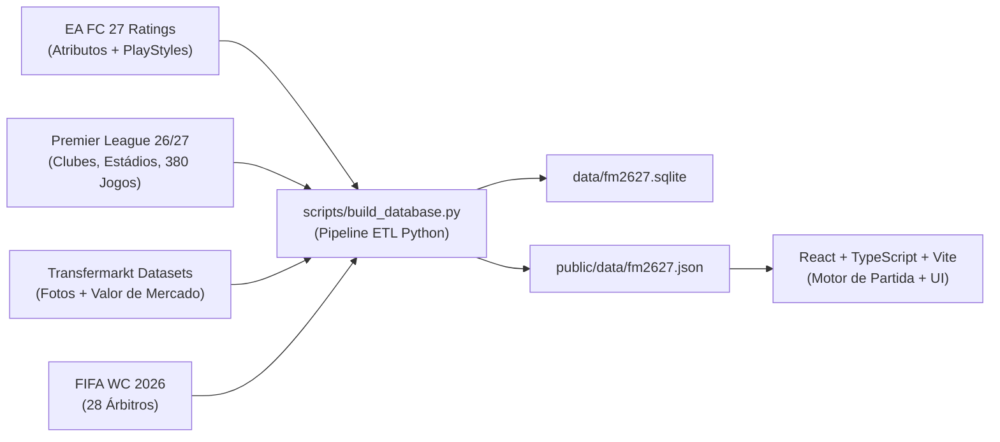

# ⚽ Football Manager 26/27 — Premier League Edition


Simulador interativo de gerenciamento de futebol focado na temporada **Premier League 2026/27**, alimentado por dados reais de jogadores, clubes, estádios, técnicos, árbitros e calendário completo de 38 rodadas.

[](https://vercel.com/new/clone?repository-url=https%3A%2F%2Fgithub.com%2Fsalanmato%2Ffootball-manager)

---

## ✨ Funcionalidades Principais

- **🏟️ 20 Clubes Reais da Premier League 2026/27**: Inclui os clubes remanescentes e promovidos (como Coventry City, Hull City, Ipswich Town, Leeds United e Sunderland), com elencos reais, técnicos, orçamento e contexto da temporada anterior.
- **🎯 Prancheta Tática Interativa**: Formações `4-3-3`, `4-4-2`, `4-2-3-1`, `3-5-2` e `5-3-2`, mentalidade (`Defensiva`, `Equilibrada`, `Ofensiva`), altura da pressão, estilo de passe, escalação automática (`Escalar Melhor 11`) e troca rápida entre titulares, banco e reservas.
- **📡 Dia de Jogo com Campinho 2D ao Vivo (`LivePitch2D`)**:
  - Simulação minuto a minuto simultânea das **10 partidas da rodada** (`1x`, `4x`, `Pausar`, `Simular Fim`).
  - Radar 2D horizontal em tempo real com movimentação dos 22 jogadores e da bola sincronizada com a posse de bola, tática e eventos reais (`GOOOOL`, `DEFESAÇA`, `QUASE`, cartões amarelos e vermelhos).
  - Painel lateral de **Substituições & Tática** ao vivo: mude instruções e faça até 5 substituições clicando diretamente no atleta no campinho ou na lista lateral.
  - Estatísticas em tempo real: Posse de bola, Gols Esperados (`xG`), Finalizações, No Alvo, Escanteios, Faltas e Craque da Partida (`MOTM`).
- **🏗️ Gestão Completa de Estádio**:
  - Controle o preço dos ingressos (`€30` a `€120`) com prévia instantânea de ocupação, público e receita por partida.
  - Escolha o preparo do gramado (`Grama Curta & Irrigada`, `Padrão`, `Grama Alta & Pesada`) com sinergias táticas reais para jogos em casa.
  - Invista o caixa do clube em **expansão de arquibancada (+2.500 lugares)**, **Setor VIP (Níveis 1–5)** e **Gramado Híbrido & Fisioterapia (Níveis 1–5)**.
  - Receitas de bilheteria são creditadas automaticamente no caixa após cada jogo em casa.
- **🌍 Mercado de Transferências Global**: Mais de **1.096 atletas** (506 da Premier League + 590 estrelas internacionais com overall $\ge 78$ de La Liga, Serie A, Bundesliga, Ligue 1, Championship, Eredivisie, Liga Portugal, MLS e mais), com filtros por posição, liga, idade, overall, valor de mercado e ficha completa com os 24 atributos do EA FC 27.
- **🏆 Hub da Liga & Persistência**: Classificação completa com zonas europeias e rebaixamento, artilharia, líderes de assistências, navegador das **380 partidas** oficiais e salvamento automático no `localStorage` (com exportação/restauração em JSON).

---

## 🧱 Arquitetura e Pipeline de Dados



### Fontes de Dados Utilizadas
- **EA FC 27 Player Ratings** (`dahipoomjj/ea-fc-27-player-ratings-and-detailed-in-game-stats`) — ratings, posições, PlayStyles+, FC IQ roles e atributos detalhados.
- **Premier League 2026/27 Season** (`dataenthusiast007/2026-27-premier-league-season`) — clubes, estádios e capacidades reais 2026/27, técnicos e tabela oficial das 38 rodadas.
- **Transfermarkt Datasets** (`dcaribou/transfermarkt-datasets`) — cruzamento de **860 fotos reais**, valores de mercado e contratos.
- **FIFA World Cup 2026 Dataset** (`mominullptr/fifa-world-cup-2026-dataset`) — quadro de 28 árbitros com média de cartões por partida.

---

## 🚀 Rodando Localmente

### Pré-requisitos
- **Node.js 20+** e `npm`
- **Python 3.10+** *(opcional — apenas se quiser reconstruir o banco de dados via ETL)*

### Instalação e Execução

```bash
git clone https://github.com/salanmato/football-manager.git
cd football-manager
npm install
npm run dev
```

Abra `http://localhost:5173/` no navegador.

### Scripts Disponíveis

| Comando | Descrição |
| :--- | :--- |
| `npm run dev` | Inicia o servidor de desenvolvimento Vite com HMR |
| `npm run build` | Executa checagem TypeScript (`tsc`) e gera o bundle de produção em `dist/` |
| `npm run preview` | Visualiza localmente o build de produção |
| `npm run etl` | Reexecuta `scripts/build_database.py` para atualizar `data/fm2627.sqlite` e `public/data/fm2627.json` |

---

## ☁️ Deploy na Vercel

O projeto já inclui `vercel.json` configurado para **Vite SPA** e cache otimizado para o dataset estático (`/data/fm2627.json`):

1. Acesse [vercel.com/new](https://vercel.com/new) e importe o repositório `salanmato/football-manager`.
2. A Vercel detectará automaticamente o framework **Vite** (`npm run build` $\to$ `dist/`).
3. Clique em **Deploy**. Nenhuma variável de ambiente é necessária.

---

## 📄 Licença

Distribuído sob a licença MIT. Consulte [LICENSE](LICENSE) para mais informações.
